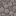
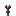

# Items

Every block and item in the game and how it behaves in Survival. Generated by
`scripts/item_wiki.py` from the game's own tables (`item.h`, `mining.h`, `recipes.h`,
`mob_drops.h`); regenerate it after changing them:

```bash
g++ -std=c++20 -I include -I Libraries/include scripts/item_wiki.cpp -o scripts/item_wiki
./scripts/item_wiki > /tmp/items.json && uv run scripts/item_wiki.py /tmp/items.json
```

Break times follow Minecraft's rules: a block's hardness, sped up by the right tool
(wood ×2, stone ×4). Blocks marked *needs tool* drop nothing without it and take
more than three times longer.

## Blocks

| | Block | ID | Hardness | Best tool | By hand | Wooden tool | Stone tool | Drops | Notes |
|---|---|---|---|---|---|---|---|---|---|
|  | Grass Block | 1 | 0.6 | shovel | 0.9 s | 0.45 s | 0.25 s | Dirt | solid |
|  | Dirt | 2 | 0.5 | shovel | 0.75 s | 0.4 s | 0.2 s | Dirt | solid |
|  | Stone | 3 | 1.5 | pickaxe (needs tool) | 7.5 s | 1.15 s | 0.6 s | Cobblestone | solid |
|  | Coal Ore | 4 | 3 | pickaxe (needs tool) | 15 s | 2.25 s | 1.15 s | Coal | solid |
|  | Bedrock | 5 | – | any | unbreakable | unbreakable | unbreakable | nothing | solid |
|  | Water | 6 | – | any | unbreakable | unbreakable | unbreakable | nothing | liquid |
|  | Sand | 7 | 0.5 | shovel | 0.75 s | 0.4 s | 0.2 s | Sand | solid |
|  | Glowstone | 8 | 0.3 | any | 0.45 s | 0.45 s | 0.45 s | Glowstone | solid, light 15 |
|  | Wood | 9 | 2 | axe | 3 s | 1.5 s | 0.75 s | Wood | solid |
|  | Leaves | 10 | 0.2 | any | 0.3 s | 0.3 s | 0.3 s | Apple (1 in 200) | see-through |
|  | Snow | 11 | 0.2 | shovel | 0.3 s | 0.15 s | 0.1 s | Snow | solid |
|  | Gravel | 12 | 0.6 | shovel | 0.9 s | 0.45 s | 0.25 s | Gravel | solid |
|  | Cactus | 13 | 0.4 | any | 0.6 s | 0.6 s | 0.6 s | Cactus | solid |
|  | TNT | 14 | 0 | any | instant | instant | instant | TNT | solid |
|  | Tall Grass | 15 | 0 | any | instant | instant | instant | nothing | plant |
|  | Dandelion | 16 | 0 | any | instant | instant | instant | Dandelion | plant |
|  | Poppy | 17 | 0 | any | instant | instant | instant | Poppy | plant |
|  | Oak Planks | 18 | 2 | axe | 3 s | 1.5 s | 0.75 s | Oak Planks | solid |
|  | Cobblestone | 19 | 2 | pickaxe (needs tool) | 10 s | 1.5 s | 0.75 s | Cobblestone | solid |
|  | Crafting Table | 20 | 2.5 | axe | 3.75 s | 1.9 s | 0.95 s | Crafting Table | solid |
|  | Lava | 21 | – | any | unbreakable | unbreakable | unbreakable | nothing | liquid, light 15 |
|  | Obsidian | 22 | 50 | pickaxe (needs tool) | 250 s | 125 s | 62.5 s | nothing | solid |
|  | Torch | 23 | 0 | any | instant | instant | instant | Torch | plant, light 14 |

## Tools and weapons

Bare hand: 1 damage, 4 attacks/s. Damage is in half-hearts; a full-strength hit needs the attack to recharge (1 / attack speed).

| | Item | ID | Kind | Tier | Damage | Attacks/s | Stack |
|---|---|---|---|---|---|---|---|
|  | Iron Sword | 256 | sword | iron | 6 | 1.6 | 1 |
|  | Wooden Pickaxe | 260 | pickaxe | wood | 2 | 1.2 | 1 |
|  | Wooden Axe | 261 | axe | wood | 7 | 0.8 | 1 |
|  | Wooden Shovel | 262 | shovel | wood | 2.5 | 1 | 1 |
|  | Wooden Sword | 263 | sword | wood | 4 | 1.6 | 1 |
|  | Stone Pickaxe | 264 | pickaxe | stone | 3 | 1.2 | 1 |
|  | Stone Axe | 265 | axe | stone | 9 | 0.8 | 1 |
|  | Stone Shovel | 266 | shovel | stone | 3.5 | 1 | 1 |
|  | Stone Sword | 267 | sword | stone | 5 | 1.6 | 1 |

## Food

Hold right click for 1.6 s to eat (only when not full). Food points are half drumsticks.

| | Item | ID | Food | Saturation | Stack |
|---|---|---|---|---|---|
|  | Apple | 259 | 4 | 2.4 | 64 |
|  | Raw Porkchop | 268 | 3 | 1.8 | 64 |
|  | Raw Beef | 269 | 3 | 1.8 | 64 |
|  | Raw Chicken | 270 | 2 | 1.2 | 64 |
|  | Raw Mutton | 271 | 2 | 1.2 | 64 |

## Materials

| | Item | ID | Stack |
|---|---|---|---|
|  | Stick | 257 | 64 |
|  | Coal | 258 | 64 |

## Crafting

Shapes match anywhere in the grid and mirrored. 2×2 recipes work in the inventory (E);
larger ones need a crafting table.

| Result | Pattern | Where |
|---|---|---|
| Oak Planks ×4 | Wood | inventory |
| Stick ×4 | Oak Planks<br>Oak Planks | inventory |
| Torch ×4 | Coal<br>Stick | inventory |
| Crafting Table | Oak Planks · Oak Planks<br>Oak Planks · Oak Planks | inventory |
| Wooden Pickaxe | Oak Planks · Oak Planks · Oak Planks<br>— · Stick · —<br>— · Stick · — | crafting table |
| Wooden Axe | Oak Planks · Oak Planks<br>Oak Planks · Stick<br>— · Stick | crafting table |
| Wooden Shovel | Oak Planks<br>Stick<br>Stick | crafting table |
| Wooden Sword | Oak Planks<br>Oak Planks<br>Stick | crafting table |
| Stone Pickaxe | Cobblestone · Cobblestone · Cobblestone<br>— · Stick · —<br>— · Stick · — | crafting table |
| Stone Axe | Cobblestone · Cobblestone<br>Cobblestone · Stick<br>— · Stick | crafting table |
| Stone Shovel | Cobblestone<br>Stick<br>Stick | crafting table |
| Stone Sword | Cobblestone<br>Cobblestone<br>Stick | crafting table |

## Mob drops

| Mob | Drops |
|---|---|
| Pig | Raw Porkchop ×1–3 |
| Cow | Raw Beef ×1–3 |
| Sheep | Raw Mutton ×1–2 |
| Chicken | Raw Chicken ×1 |
| Zombie | nothing |
| Skeleton | nothing |
| Creeper | nothing |
| Spider | nothing |
| Creeper Cow | nothing |

Item and new block textures: Pixel Perfection (CC BY-SA 4.0), credited in
`assets/Textures/README.md` and `assets/Textures/items/README.md`.
